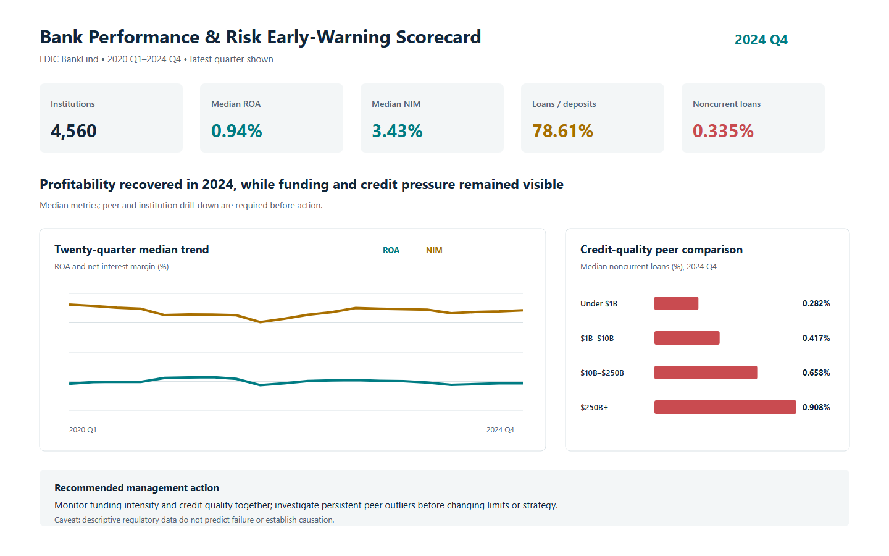

## 1. Title

# Bank Performance and Risk Early-Warning Scorecard

An Oracle SQL, PL/SQL, and Power BI portfolio case study using official FDIC institution-level quarterly financial data.

## 2. Executive Summary

Bank finance and risk teams need to see whether stronger earnings are being achieved alongside sustainable funding and acceptable credit quality. This project uses 96,902 official FDIC institution-quarter records from 2020 Q1 through 2024 Q4 to create a validated performance and peer-benchmarking scorecard. Oracle SQL prepares and analyzes the data, PL/SQL controls batch quality, and the Power BI design turns the results into executive, peer, risk, and institution-level views.

The analysis found that median ROA improved from 0.882% in 2024 Q1 to 0.936% in Q4, while median loans-to-deposits reached 78.605% and median noncurrent loans rose 32.2% relative to 2023 Q4. I recommend peer-relative monitoring, combined funding-and-credit reviews, and separate treatment for the 14 institutions above $250 billion. Next steps are to compile the Oracle solution, build and reconcile the native Power BI report, and add institution-history data to explain changes in the reporting population.

## 3. Business Problem

Bank executives cannot evaluate performance from one earnings number. Profitability can improve while funding pressure, credit deterioration, or portfolio concentration rises. Comparisons can also mislead when a community bank is measured against a globally active institution.

The intended stakeholders are finance leadership, asset-liability committees, risk management, strategy teams, and regional executives. The central business question is:

> How can stakeholders identify meaningful changes in bank performance and risk, compare each institution with relevant peers, and decide which movements require investigation?

The project answers four supporting questions:

1. How did industry profitability, margin, funding, lending, capital, and asset-quality indicators change from 2020 Q1 to 2024 Q4?
2. How do those indicators differ across documented asset-size peer groups?
3. Which institutions combine low peer-relative profitability with high peer-relative noncurrent loans and therefore warrant analyst review?
4. Which year-over-year changes are large enough to investigate through institution-level drill-through?

The scorecard is a descriptive screening tool. It does not predict bank failure, assign regulatory ratings, or establish why a metric changed.

## 4. Methodology

1. **Extract the data.** Download 29 documented fields from the public [FDIC BankFind Financials API](https://api.fdic.gov/banks/docs) for the fixed 2020 Q1–2024 Q4 period.
2. **Validate the source.** Check the file hash, row count, reporting dates, required numeric values, nulls, and unique institution-quarter keys before analysis.
3. **Build the Oracle model.** Separate raw staging data from typed institution, reporting-quarter, peer-band, and financial fact tables.
4. **Control data quality with PL/SQL.** Reject incomplete or invalid batches, log validation issues, and promote data only after every required check succeeds.
5. **Calculate business KPIs.** Derive quarterly net income, profitability, margin, funding, capital, and credit-quality measures; then calculate peer medians and percentiles.
6. **Design Power BI reporting.** Specify executive overview, peer benchmarking, risk diagnostics, and institution detail pages with documented DAX and reconciliation controls.
7. **Verify the result.** Re-extract the FDIC source, rebuild the outputs, run unit tests, reconcile README numbers, and test the public GitHub links.

### Project outline

| Area | Main deliverables |
|---|---|
| Data acquisition | Reproducible API extraction and immutable source manifest |
| Oracle SQL | Schema, validation view, analytical views, business queries, and reconciliations |
| Oracle PL/SQL | Batch validation and promotion package |
| Analytics | Verified quarterly and peer-group CSV outputs |
| Power BI | Semantic model, DAX measures, page design, mobile layout, and QA checklist |
| Presentation | Dashboard preview, seven-section README, data dictionary, methodology, and verification reports |

## 5. Skills

**Oracle SQL:** External-table loading, typed staging, constraints, joins, CTEs, `CASE`, aggregate functions, `LAG`, `PERCENT_RANK`, `PERCENTILE_CONT`, peer segmentation, data-quality validation, and KPI reconciliation.

**Oracle PL/SQL:** Package specification/body, controlled batch state, procedures, explicit application errors, exception handling, savepoints, validation logging, and atomic promotion design.

**Power BI:** Star-schema design, Power Query responsibility boundaries, DAX time intelligence, KPI measures, peer benchmarking, drill-through, mobile layout, accessibility, and SQL-to-dashboard reconciliation.

**Business Analytics:** Bank profitability, net interest margin, funding intensity, credit quality, capital, regulatory data interpretation, peer comparison, trend analysis, and executive recommendations.

**Data Engineering & QA:** API pagination, immutable source manifest, SHA-256 verification, null handling, duplicate-key controls, reproducible extracts, unit tests, and transparent verification status.

## 6. Results & Business Recommendation

### Verified findings

- **Industry consolidation with balance-sheet growth:** reporting institutions declined from 5,182 in 2020 Q1 to 4,560 in 2024 Q4, a 12.0% reduction. Over the same endpoints, total assets rose from $20.44 trillion to $24.36 trillion and deposits rose from $15.88 trillion to $19.35 trillion. These are descriptive changes; the dataset does not by itself assign the decline to mergers, failures, or reporting changes.
- **Profitability recovered during 2024:** median ROA rose from 0.882% in Q1 to 0.936% in Q4, while median NIM increased from 3.329% to 3.428%. Median ROA nevertheless remained below its 2021 quarterly peak in this dataset.
- **Funding intensity remained elevated:** median loans-to-deposits was 78.605% in 2024 Q4, 0.945 percentage points above 2024 Q1. This does not prove a liquidity problem, but it supports joint monitoring of lending growth and funding structure.
- **Credit quality weakened from a low base:** median noncurrent loans increased from 0.253% in 2023 Q4 to 0.335% in 2024 Q4, a 0.082 percentage-point or 32.2% relative increase.
- **Peer context materially changes interpretation:** in 2024 Q4, median noncurrent loans ranged from 0.282% for institutions under $1 billion to 0.908% for the 14 institutions above $250 billion. The largest-bank group also had a lower median NIM (2.834%) and lower median loans-to-deposits (56.679%) than the under-$1-billion group. The $250-billion-plus result must be read cautiously because the peer contains only 14 institutions.
- **Quarterly net-income coverage is explicit:** the derived 2024 Q4 net-income total covers 99.52% of reporting institutions; rows with missing source `NETINC` are not treated as zero.

### Recommendations

1. **Use peer-relative screening, not universal thresholds.** Review institutions that remain below the 10th ROA percentile and above the 90th noncurrent-loan percentile within the same asset-size band for two consecutive quarters. This is a proposed investigation rule, not an FDIC standard or distress classification.
2. **Review funding and credit quality together.** Escalate a diagnostic review when rising loans-to-deposits coincides with worsening noncurrent loans, then inspect deposit mix, loan concentration, allowance coverage, and institution context before changing strategy.
3. **Keep large-bank findings separate.** The 14 institutions above $250 billion have structurally different balance sheets; management reporting should not blend them with community and regional banks.
4. **Measure success through review quality.** Track the number of persistent peer outliers, the share receiving documented analyst review, false-positive explanations, and whether flagged movements normalize or persist in later quarters.

### Important limitations

- FDIC data are regulatory financial records, not customer-level behavior or credit files.
- Accounting definitions, mergers, charter changes, and reporting populations can change over time.
- Peer percentile flags are descriptive and do not predict failure or establish causation.
- Monetary API fields are reported in thousands of dollars; the processed summaries convert totals to millions.
- Oracle compilation and native Power BI rendering remain untested because those runtimes were unavailable. The static dashboard is a generated preview, not a `.pbix` screenshot.

## 7. Next Steps

1. Execute and compile all Oracle scripts against Oracle Database 19c or newer, then attach the reconciliation output and PL/SQL test log.
2. Build the native Power BI report from the supplied model and DAX, reconcile every card to the committed CSVs, and test desktop/mobile interactions.
3. Add FDIC institution-history events so the decline in reporter count can be separated into mergers, closures, new reporters, and other structural changes.
4. Test alternative peer definitions using specialization group and community-bank designation, then document whether screening results are stable.
5. Extend the refresh process to later quarters only after the fixed historical build remains reproducible.
